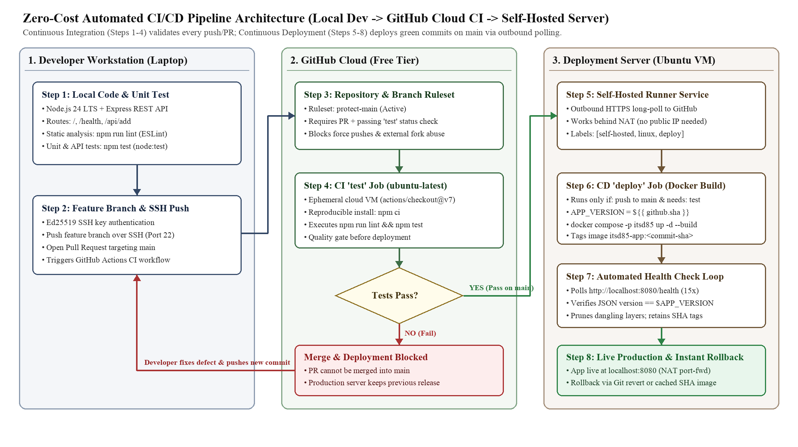

# ITSD 85 Lab 6: Automated CI/CD Pipeline
Student(s): Jan Eduard Sanchez   Section: BSIT   Instructor: ITSD 85 Instructor

## What this project does
A small Node.js and Express web API (`/`, `/health`, and `/api/add`) with automated unit tests (`node:test`), static code linting (`ESLint`), Docker container packaging, and an automated GitHub Actions CI/CD workflow.

## Pipeline diagram


## How to run locally
```bash
npm install
npm run lint
npm test
npm run dev
```
Open `http://localhost:3000` and `http://localhost:3000/health` in your browser.

## How the deployment works
1. **Continuous Integration (`test` job)**: Runs automatically on GitHub's `ubuntu-latest` runner on every push and pull request to `main`. It installs dependencies using `npm ci`, checks code quality with `npm run lint`, and runs automated tests with `npm test`.
2. **Continuous Deployment (`deploy` job)**: Runs on our self-hosted Ubuntu Server runner (`[self-hosted, linux, deploy]`) only after the `test` job passes on a push to `main`. It builds and starts the container with `docker compose -p itsd85 up -d --build --remove-orphans`, tags the image with the commit SHA (`APP_VERSION`), and verifies `http://localhost:8080/health`.

## Results
| Test | Expected result | Actual result | Push-to-live time (min:sec) | Screenshot no. |
| :--- | :--- | :--- | :---: | :--- |
| **A – good change** | `test` ✔, `deploy` ✔, new name and commit ID live | `test` ✔, `deploy` ✔, homepage title and commit SHA updated | `01:36` | Checkpoint 6 |
| **B – broken change** | `test` ✘, merge blocked, server unchanged | `test` ✘ (`add()` failed), merge blocked, server kept previous version | `n/a` | Test B PR |
| **C – rollback (Method 1)** | old content and a new commit ID live | `git revert` merged via PR, old title restored with new commit SHA | `01:34` | Test C Method 1 |
| **C – rollback (Method 2)** | previous commit ID live within seconds | Previous commit image started with `--no-build` in 4 seconds | `00:04` | Test C Method 2 |

## Screenshots
- [Checkpoint 1 – Tool versions and SSH test](docs/screenshots/cp1-versions.png)
- [Checkpoint 2 – Local tests passing and dev page](docs/screenshots/cp2-local-tests.png)
- [Checkpoint 3 – GitHub repository file list](docs/screenshots/cp3-github-repo.png)
- [Checkpoint 4 – Green CI test job](docs/screenshots/cp4-ci-test-green.png)
- [Checkpoint 5 – Docker hello-world and manual dry run](docs/screenshots/cp5-server-manual-dryrun.png)
- [Checkpoint 6 – Self-hosted runner and live deployment](docs/screenshots/cp6-deploy-green.png)

## Paper
- [Lab Report & IEEE Paper (Word Document)](docs/ITSD85_Lab6_Sanchez_Paper.docx)
